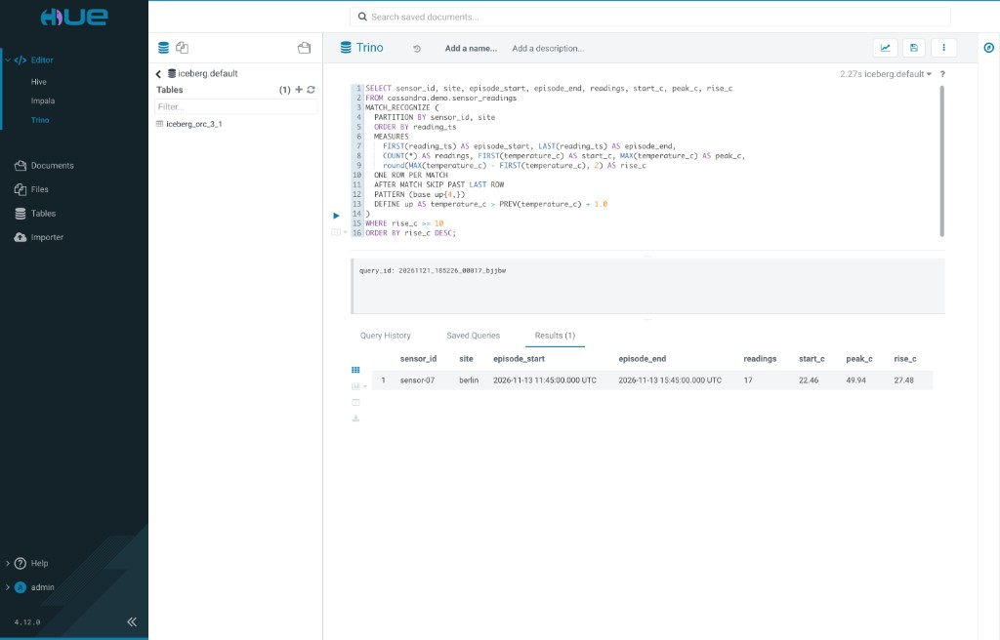
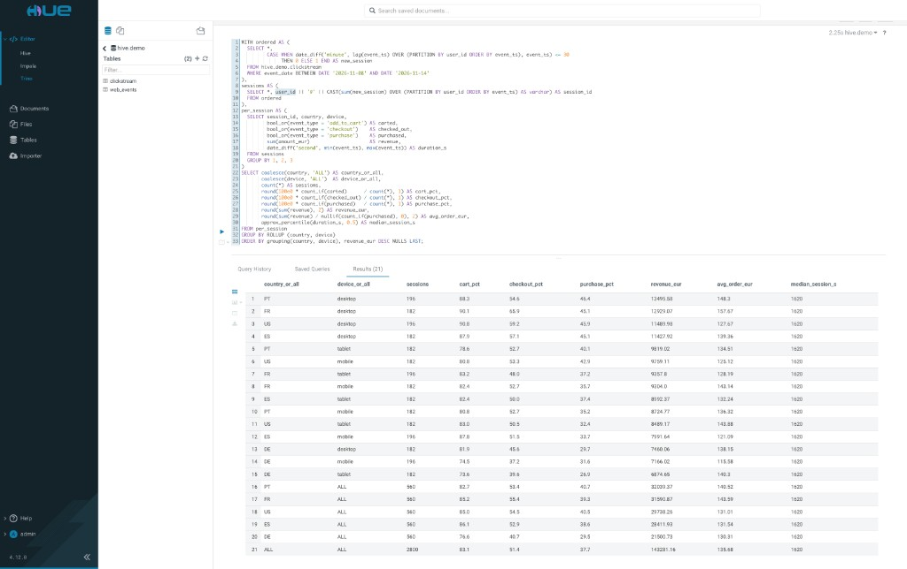

# BigData on Kubernetes Lab

> `hiveCtl.sh` manages the full lab stack (Hive, HDFS, Ranger, Kerberos, Cassandra, Trino, Impala, Hue), not only Hive.



*Hue's Trino editor on the `warehouse` profile: `MATCH_RECOGNIZE` over the Cassandra table `cassandra.demo.sensor_readings` finds a sensor's overheating episode ([sample](samples/trino/cassandra-sensor-showcase.sql)).*



*Same editor on Hive: sessionization with window functions and a conversion funnel with `ROLLUP` subtotals over the partitioned ORC table `hive.demo.clickstream` ([sample](samples/trino/hive-clickstream-showcase.sql)).*

## Author

José Martínez-Poblete  
j.martinez.poblete@gmail.com

## Usage Notice

This project is not meant for commercial use without permission and proper credit.

Author: j.martinez.poblete@gmail.com

The same two-line header appears at the top of every source file in this repository (shell scripts, YAML manifests, XML config, and `kind` templates):

```text
# Usage Notice: This project is not meant for commercial use without permission and proper credit.
# Author: j.martinez.poblete@gmail.com
```

This project runs Apache Hive on Kubernetes using upstream/minimal container images from Docker Hub (`apache/hive`). Image tags differ by profile; see **Images by profile** below.

The manifests intentionally complete the images at pod startup by installing small OS packages and writing runtime configuration from ConfigMaps. Because those images are minimal, the startup scripts use `root` for bootstrap work and then run Hive/Hadoop services as their application users.

## What's New (November 2026)

The **`warehouse`** profile now has two SQL engines next to Hive. Both use the same Kerberized Hive Metastore and HDFS, so Hive, Trino, and Impala see the same tables. Both have an editor in Hue.

### Trino: one engine for the lake and the databases

- **Trino 484**, one coordinator and two workers, Kerberos to the Hive Metastore (`trino/<host>@WAREHOUSE.LAB`).
- **Catalogs:**
  - `hive` and `iceberg` read the HDFS warehouse.
  - `cassandra` reads a Kerberos-only Cassandra ring through a password + mTLS node in a second datacenter ([design](docs/cassandra-trino-two-dc-design.md)).
  - `mysql`, `postgres`, and `oracle` read each database's `bigdata` schema ([catalogs](docs/trino-database-catalogs.md)).
- **Provisioning:** `./hiveCtl.sh start warehouse` creates the passwords, schemas, Trino database users, Cassandra certificates, and Cassandra role, so a new cluster comes up with every catalog working.
- **Access:** a **Trino editor in Hue** (custom `hue-trino` image), and the Trino UI on NodePort `30080`. Guides: [Iceberg runbook](docs/trino-iceberg-runbook.md), [warehouse profile](docs/warehouse-profile.md).

### Impala: an MPP engine next to the DataNodes

- **Impala 4.5.3**: statestore, CatalogD, and three `impalad`s that coordinate and execute. Each `impalad` runs on a node with an HDFS DataNode, one per node. Placement follows the DataNodes' local-path volumes, so the `impalad`s move with them after a restore. Reads still go over the pod network, so Impala doesn't count them as local.
- **Shared metastore:** CatalogD reads the Hive 4 Metastore over Kerberos and picks up Hive changes through metastore events (`hive.metastore.dml.events=true`). Tables written by Hive appear in Impala without a manual refresh.
- **Hive 4 compatibility:** the official Impala images reject Hive 4 tables ("access type is: NONE"). This repo ships `jpoblete73/impala:4.5.3-*-hive4`, the official images with one patched class ([`docker/impala-hive4`](docker/impala-hive4)).
- **Impala editor in Hue** goes through Service `impala`, so any coordinator can serve it:
  - The `impalad`s share the Kerberos principal `impala/impala.warehouse.svc.cluster.local`.
  - The Service uses client-IP affinity, which keeps an HS2 session on one coordinator.
  - If that coordinator goes down, the next query runs on another one.
- **Startup order:** Impala starts after HiveServer2 and before Trino, and stops in reverse order. `hiveCtl.sh` creates the Impala Kerberos principals, even on a cluster whose KDC predates Impala.
- **Also in `secure`:** the same Impala layout and Hue editor, with realm `SECURE.LAB` and principal `impala/impala.secure.svc.cluster.local`.
- **Verified on the live cluster (`warehouse`):** `INSERT` and `SELECT` on Parquet, and `SELECT` with `GROUP BY` on Iceberg. Row counts match Trino.

Details: [warehouse profile, Impala section](docs/warehouse-profile.md#impala) · [operations notes](docs/operations-notes.md).

## Performance: LLAP, ACID, and a real cluster

End-to-end **benchmarks** on Kubernetes with **Kerberos** (`secure` profile):

- **LLAP:** Sub-second DAG times for tuned aggregations; partition pruning ~**0.11 s**; cache warm/hit runs ~**0.56–0.58 s**.
- **ACID:** Managed table mutations (INSERT / DELETE / UPDATE / SELECT across deltas) on **10k**-row ORC baselines.
- **Stress:** Cross-join + window workload spills ~**177 MB** to scratch without pod failure (~**144 s**).

Full methodology, SQL, and tables: **[docs/benchmark-llap-acid-2026-11.md](docs/benchmark-llap-acid-2026-11.md)** (November 2026).

## Contents

Read **Profiles** in order (simplest first). UIs and kind setup are grouped under **[Browser UIs & kind](#browser-uis-and-kind-standalone--mini--llap--secure--warehouse)**.

- [**What's New (Nov 2026)**](#whats-new-november-2026) — Trino and Impala in `warehouse`
- [**LLAP & ACID benchmark (Nov 2026)**](docs/benchmark-llap-acid-2026-11.md) — **real-cluster** timings: analytical + transactional workloads
- [Images by profile](#images-by-profile)
- [Prerequisites](#prerequisites) · [Hardware](#hardware-requirements)
- [**Profiles**](#profiles) — `standalone` → `mini` → `llap` → `secure` → `warehouse`
- [**Secure profile (detailed)**](docs/secure-profile.md) — Kerberos ZK, Tez jar cache, disk, smoke tests
- [**Warehouse profile**](docs/warehouse-profile.md) — secure stack + Cassandra + Trino + Impala + custom Hue
- [Browser UIs & kind (all Hue profiles)](#browser-uis-and-kind-standalone--mini--llap--secure--warehouse)
- [Data safety](#data-safety) · [Bootstrap model](#bootstrap-model) · [Lab OS users](#lab-os-users-supergroup)
- [Smoke tests](#smoke-tests) · [Validation](#validation)

## Images by profile

```text
standalone:   apache/hive:4.2.0   (embedded Metastore + HiveServer2 in one pod)
              gethue/hue:latest (Hue → HS2; MySQL pod for Hue DB only)
mini:         apache/hive:4.2.0   (Hive Metastore + HiveServer2)
              apache/hadoop:3.4.1 (single-node HDFS in one pod)
              gethue/hue:latest
llap:         apache/hive:nightly (Hive Metastore x2, HiveServer2 x2, LLAP daemon x2)
              apache/hadoop:3.4.1, gethue/hue:latest
secure:       apache/hive:nightly (same LLAP stack as llap: Metastore x2, HiveServer2 x2, LLAP daemon x2)
              apache/hadoop:3.4.1 (HDFS: 1 NameNode + 3 DataNode StatefulSets; Kerberos; dfs.replication=3)
              debian:bookworm-slim (MIT KDC in krb5kdc-0)
              gethue/hue:latest (Hue → HS2 and Impala with SASL/Kerberos backend)
              apache/impala:4.5.3-statestored + jpoblete73/impala:4.5.3-{catalogd,impalad_coord_exec}-hive4
                (same Impala layout as warehouse)
warehouse:    apache/hive:nightly, apache/hadoop:3.4.1, debian:bookworm-slim (MIT KDC)
              cassandra:4.1.12 + Kerberos authenticator (hive-on-k8s/cassandra-kerberos:4.1.12, custom)
              cassandra-trino: 1-node `trino` DC (password + mTLS) that Trino reads
              trinodb/trino:484 (hive, iceberg, cassandra, mysql, postgres, oracle catalogs)
              apache/impala:4.5.3-statestored + jpoblete73/impala:4.5.3-{catalogd,impalad_coord_exec}-hive4
                (custom: one patched class for the Hive 4 metastore; 3 impalad next to the DataNodes)
              hive-on-k8s/hue-trino (custom: gethue/hue + SQLAlchemy 1.4 + sqlalchemy-trino; Hive, Trino, Impala editors)
```

`mini` and `standalone` pin the released **4.2.0** image. **`llap` and `secure` use the moving `nightly` tag** (Beeline reports **4.3.0-SNAPSHOT** today) so Tez and LLAP pick up fixes not in 4.2.0—notably [HIVE-29566](https://issues.apache.org/jira/browse/HIVE-29566), where reopening a Tez session in the same HiveServer2 JVM could fail with `JvmMetrics already exists` on grouped/aggregating queries. After an image bump, metastore pods run `schematool` on startup if the schema version changed. Leave headroom on kind or Docker Desktop nodes when pulling `nightly` (~1.5 GiB per node that schedules a Hive pod). To pin `llap` / `secure` to a release tag again, change the image patch in each profile’s `hivemetastore`, `hiveserver2`, and `llapdaemon` kustomizations.

## Prerequisites

Install these tools on the machine where you run `hiveCtl.sh` (the same host you use for `kubectl`, not inside cluster nodes):

| Tool | Required | Notes |
|------|----------|--------|
| **`kubectl`** | Yes | Cluster admin or sufficient RBAC to create namespaces, StatefulSets, PVCs, Secrets, etc. |
| **`kustomize`** | Yes (auto) | `hiveCtl.sh` runs `kustomize build … \| kubectl apply -f -` for every component (not `kubectl apply -k`). If **`kustomize`** is missing, **`hiveCtl`** downloads it into **`.bin/kustomize`** on first **`start`** / **`restore`** (needs **`curl`**). Disable: **`HIVECTL_KUSTOMIZE_INSTALL=0`**. Pin: **`HIVECTL_KUSTOMIZE_VERSION=5.4.3`**. |
| **`curl`** | Yes* | Required only when kustomize must be bootstrapped into `.bin/`. |
| **`shellcheck`** | No | Optional; used by [Validation](#validation). |

Manual **kustomize** install (optional — any copy on `PATH` is used before `.bin/`):

```bash
curl -s "https://raw.githubusercontent.com/kubernetes-sigs/kustomize/master/hack/install_kustomize.sh" | bash
sudo install -m 0755 kustomize /usr/local/bin/kustomize
kustomize version
```

You also need a Kubernetes cluster reachable from that host, for example:

```text
Docker Desktop Kubernetes
kind
minikube
```

## Hardware Requirements

The manifests define resource requests and limits for local Kubernetes labs. The sizes below assume **one profile (overlay) running at a time** — do not start `standalone`, `mini`, `llap`, `secure`, and `warehouse` together on the same cluster. Each profile uses its own namespace and PVCs, but they still compete for **the same Docker Desktop / kind VM memory and disk** (duplicate **~1.5 GiB** `apache/hive` / **~1.2 GiB** `apache/hadoop` pulls per node, plus PVCs). Stop other profiles first: `./hiveCtl.sh stop <other>` (PVCs are kept). For **`llap`** and **`secure`**, treat **one active overlay** as required on a **~36 GB RAM** host with default Docker disk.

For the `mini` profile, a cluster with **3 worker nodes** is suggested so Hadoop, MySQL, Metastore, and HiveServer2 have room to schedule cleanly across the local cluster.

Minimum practical host sizes (**one profile active**):

```text
standalone only:
  host RAM:        12 GB+
  Kubernetes RAM:  6 GB+
  CPUs:            2+
  disk:            10 GB+

mini only:
  host RAM:        16 GB+
  Kubernetes RAM:  10-12 GB+
  CPUs:            4+
  disk:            20 GB+

llap only:
  host RAM:        32 GB+
  Kubernetes RAM:  20-24 GB+
  CPUs:            6+
  disk:            30 GB+
  worker nodes:    2+ (one LLAP daemon per node)

secure only:
  host RAM:        36 GB+
  Kubernetes RAM:  26-30 GB+
  CPUs:            8+
  disk:            50 GB+ host Docker VM (see below; PVCs alone are ~51 Gi on secure)
  worker nodes:    3+ for DataNodes; 2+ labeled llap (same as llap profile) for LLAP daemons

warehouse only (measured on the live cluster, Nov 2026; use a real cluster):
  pod requests:    ~7 CPU, ~31 GiB RAM (Trino and cassandra-trino set none, so real need is higher)
                   + Impala ~2 CPU, ~14 GiB (3 impalad x 4 GiB, catalogd 2 GiB, statestored 256 MiB)
  pod limits:      ~28 CPU, ~67 GiB RAM (+ Impala ~8 CPU, ~22 GiB)
  idle usage:      ~0.5 CPU, ~20.6 GiB RAM, before any query
  Kubernetes RAM:  48 GiB+ for meaningful testing (64 GiB+ comfortable)
  CPUs:            12+
  disk:            ~116 GiB of PVCs requested (Oracle 20, Cassandra 4x10, HDFS 4x10, MySQL 10, Postgres 5, KDC 1)
  worker nodes:    5+ (3 DataNodes, 3 Cassandra, 2 labeled llap); amd64 recommended
```

> **`warehouse` is memory heavy. Use a real multi-node cluster for any meaningful testing, not kind.** On a 36 GB Apple M3 Pro, Docker Desktop gets ~23.4 GiB, and every kind node reports that same amount. The scheduler then sees ~140 GiB, places all pods, and they hit OOM kills. The idle stack alone (~20.6 GiB) nearly fills the VM. Several images are amd64-only (`apache/hadoop:3.4.1`, `gethue/hue:latest`, `jpoblete73/oracle-free:23.9.0.0-amd64`), so on Apple Silicon they run under emulation and are much slower. In our tests the **`llap`** profile runs fine on kind; it is the largest profile we recommend locally.

**`secure`** is **`llap` + Kerberos** (same ZooKeeper, **2×** Metastore / HiveServer2 / LLAP daemon, and Hue; HDFS **1 NN + 3 DN**; realm **`SECURE.LAB`**). **`warehouse`** is the `secure` stack plus Cassandra, Trino, and Impala (realm **`WAREHOUSE.LAB`**). Only one of **`llap`**, **`secure`**, or **`warehouse`** should be up on a lab sized for the rows above.

With kind on Docker Desktop, every node is a container in the **same** VM: **`df` on each node reflects one shared virtual disk**, not six independent disks. Adding workers spreads pods; it does not add RAM or disk. Give Docker Desktop **enough memory** for the profile and **≥100 GiB disk** if you run **`llap`** or **`secure`** with **`apache/hive:nightly`**. Before large starts: `./hiveCtl.sh disk` (auto-prunes unused images when **`/var`** is above **90%**).

Container limits are above JVM heap (overhead + native memory): Hive **3 Gi**, Hadoop **6 Gi**, MySQL **2 Gi**, LLAP daemon **5 Gi**, ZooKeeper **512 Mi**, Hue **2 Gi**. Cassandra and Trino limits for **`warehouse`** are set in `overlays/warehouse/cassandra` and `overlays/warehouse/trino`.

## hiveCtl quick reference

Kubernetes **namespace = profile name** (`standalone`, `mini`, `llap`, `secure`, `warehouse`). Run **one profile at a time** on a local lab ([Hardware](#hardware-requirements)).

| Action | Command |
|--------|---------|
| Start / stop | `./hiveCtl.sh start <profile>` · `./hiveCtl.sh stop <profile>` |
| One component | `./hiveCtl.sh start <profile> <component>` (e.g. `hue`, `llapdaemon`, `hadoop-namenode`) |
| Status | `./hiveCtl.sh status` · `kubectl get pods,pvc,svc -n <profile>` |
| Backup / restore / cleanup | `./hiveCtl.sh backup|restore|cleanup <profile> [backup-dir]` |
| Kind **`/var`** disk | `./hiveCtl.sh disk` ([Kind disk space](#kind-disk-space-imagepullbackoff)) |
| **`secure`** keytabs | `./hiveCtl.sh resync-keytabs secure` (after KDC host list changes) |
| **`warehouse`** keytabs | `./hiveCtl.sh resync-keytabs warehouse` (refreshes the Secret; then restart the Kerberos pods in `warehouse` yourself — only `secure` restarts automatically) |

**Hive CLI:** `kubectl exec -it hiveserver2-0 -n <profile> -- bash` (interactive shells auto **`su - hive`** with cwd **`/opt/hive`** on metastore / HS2 / LLAP pods) → `beeline`, `createTable.sh man managed_3_1 3 1 10 1`. **Standalone:** `hive-0` container `hiveserver2`. Details: [Smoke tests](#smoke-tests).

## Profiles

Profiles are documented **simplest first**, each step adding services and operational complexity:

```text
standalone  →  mini  →  llap  →  secure  →  warehouse
  Derby+Hue      HDFS+MySQL     ZK; 2 HMS/HS2/LLAP  same Hive tier +
  one pod        1 MS, 1 HS2    + Hue               KDC, Kerberos HDFS
                 + Hue          (all four ship Hue)
```

### `standalone`

| | |
|--|--|
| **Adds** | One pod: embedded Metastore + HiveServer2, Derby, local PVC warehouse; MySQL (Hue DB only); Hue |
| **Stack** | `mysql → hive → hue` (Derby metastore stays in the Hive pod) |
| **Overlays** | `overlays/standalone/hive`, `mysql`, `hue` |
| **Start / stop** | `./hiveCtl.sh start standalone` · `./hiveCtl.sh stop standalone` |
| **UIs** | Hue **http://localhost:8885** ([Browser UIs](#browser-uis-and-kind-standalone--mini--llap--secure--warehouse)) |
| **Try it** | [Smoke tests → standalone](#smoke-tests) |

### `mini`

| | |
|--|--|
| **Adds** | HDFS (one Hadoop pod), MySQL, Hive Metastore, HiveServer2, Hue |
| **Stack** | `hadoop → mysql → hivemetastore → hiveserver2 → hue` |
| **Overlays** | `overlays/mini/*` |
| **Start / stop** | `./hiveCtl.sh start mini` · `./hiveCtl.sh stop mini` |
| **UIs** | Hue **http://localhost:8886** ([Browser UIs](#browser-uis-and-kind-standalone--mini--llap--secure--warehouse)) |
| **HDFS** | `kubectl exec hadoop-0 -n mini -- hdfs dfs -ls /` |
| **Try it** | [Smoke tests → mini](#smoke-tests) |

### `llap`

| | |
|--|--|
| **Adds (on top of `mini`)** | ZooKeeper, **2×** Hive Metastore & HiveServer2, **2×** LLAP daemons, Hue |
| **Image** | `apache/hive:nightly` (Tez/LLAP fixes; see [Images by profile](#images-by-profile)) |
| **Hive tier** | **2** Metastore · **2** HiveServer2 · **2** LLAP daemons (StatefulSets, `replicas: 2`) |
| **Stack** | `hadoop → mysql → zookeeper → hivemetastore×2 → llapdaemon×2 → hiveserver2×2 → hue` |
| **Overlays** | `overlays/llap/*` — shared `hive-site.xml` in `llap/hivemetastore` |
| **Prerequisite** | Label **two** workers `node-role.kubernetes.io/llap` or use [`kind/llap-cluster.yaml`](kind/llap-cluster.yaml) ([details](#browser-uis-and-kind-standalone--mini--llap--secure--warehouse)) |
| **Start / stop** | `./hiveCtl.sh start llap` · `./hiveCtl.sh stop llap` |
| **UIs** | Hue **http://localhost:8887** · LLAP **http://localhost:15002** ([Browser UIs](#browser-uis-and-kind-standalone--mini--llap--secure--warehouse)) |
| **Query path** | Tez AM in HiveServer2 (**local mode**, no YARN) → fragments on `@llap0` daemons; Beeline via ZK (`BEELINE_URL` in pods) |
| **Logs on HDFS** | `hdfs://nameservice:8020/user/hive/logs/llap/…` — `tez/application_*`, `llap/application_*`, stable `*.log` ([`samples/logging/`](samples/logging/README.md)) |
| **Try it** | [Smoke tests → llap](#smoke-tests) |

### `secure`

| | |
|--|--|
| **Adds (on top of `llap`-shaped Hive)** | MIT KDC; **HDFS with three DataNodes** (`hadoop-datanode-0/1/2`, one pod per worker, **`dfs.replication=3`**); **Kerberos SASL ZooKeeper**; **LLAP×2, Hue, 2×** Metastore & HiveServer2 (same scale as **`llap`**, all Kerberos-enabled); **Impala** (statestore, CatalogD, 3× `impalad` next to the DataNodes) with a Hue Impala editor, same as **`warehouse`**. **Ranger:** design only — [docs/secure-ranger.md](docs/secure-ranger.md) |
| **Image** | `apache/hive:nightly` (see [Images by profile](#images-by-profile)) |
| **Hive tier** | **2** Metastore · **2** HiveServer2 · **2** LLAP daemons (same as **`llap`**, Kerberos-enabled) |
| **Stack** | `krb5kdc → hadoop-namenode (+ 3× datanode) → mysql → zookeeper → hivemetastore×2 → llapdaemon×2 → hiveserver2×2 → impala → hue` |
| **Prerequisite** | **Three** workers for DataNodes; **two** workers labeled **`node-role.kubernetes.io/llap`** (or [`kind/llap-cluster.yaml`](kind/llap-cluster.yaml) with enough nodes) |
| **Query path** | Same as **`llap`**: Tez AM in HiveServer2 (**local mode**) → fragments on **`@llap0`**; Beeline via ZK after **`kinit`** (`BEELINE_URL` in HS2 pods) |
| **Components** | `components/krb5kdc`, `hadoop-namenode`, `hadoop-datanode` · `overlays/secure/*` |
| **Start / stop** | `./hiveCtl.sh start secure` (KDC → Hadoop → …; first start waits for **3 DNs**) · `./hiveCtl.sh stop secure` |
| **Shells** | `hadoop-namenode-0`, `hiveserver2-0` (`su - hive`) |
| **UIs** | Hue **http://localhost:8888** · LLAP **http://localhost:15002** ([Browser UIs](#browser-uis-and-kind-standalone--mini--llap--secure--warehouse)) |
| **Logs on HDFS** | `hdfs://nameservice:8020/user/hive/logs/secure/…` — **`tez/`** and **`llap/`** query exports ([`samples/logging/`](samples/logging/README.md)) |
| **Try it** | [Smoke tests → secure](#smoke-tests) |

**Kerberos (summary):** realm **`SECURE.LAB`**, KDC pod **`krb5kdc-0`**, keytabs in Secret **`kerberos-keytabs`** (synced by `hiveCtl` from KDC PVC). Host principals **`hdfs/`**, **`hive/`**, **`hue/`** + FQDN; Tez local mode needs short-name principals (e.g. **`hive/hiveserver2-0@…`**). Resync after KDC changes: **`HIVECTL_KRB5_RESYNC_KEYTABS=1 ./hiveCtl.sh start secure`**.

**HDFS:** **Three DataNode pods** (`kubectl get pods -n secure -l app=hadoop-datanode` → **3/3**) back the **`nameservice`** nameservice with **`dfs.replication=3`**. Kerberos auth + **`dfs.data.transfer.protection=authentication`** on NN/DN; ops via **`hadoop-namenode-0`** (not the single **`hadoop-0`** pod used in **`mini`** / **`llap`**). Tez jar scratch under **`/opt/hive/install_dir/<pod>/hive/.hiveJars`** uses **`dfs.replication=1`** in HS2 bootstrap so small DN PVCs are not triple-replicated for cache files.

**Hive:** Metastore SASL, **`hive.server2.authentication=KERBEROS`**, **`tez.local.mode=true`**, LLAP execution (**`hive.execution.mode=llap`**). **`hive.server2.tez.initialize.default.sessions=true`** (same as **`llap`**: one Tez session per HS2 JVM for LLAP metrics + Kerberos local AM IPC). Per-pod **`hive.user.install.directory`** and minimal **`.hiveJars`** seed (**`HIVE_TEZ_JAR_SEED=minimal`**). Beeline: **`kinit`** then **`beeline -u "${BEELINE_URL}"`** inside an HS2 pod (ZK discovery + Kerberos).

**Hue:** **`use_sasl=true`** to HS2; File Browser WebHDFS to **`nameservice:9870`** as **`hue/…`**. Literal HS2 principal in `hue-hive-conf/hive-site.xml` (not `hive/_HOST`). Impala editor and **Jobs → Queries** through Service **`impala`**, as in [`warehouse`](docs/warehouse-profile.md#impala).

**More:** [docs/secure-profile.md](docs/secure-profile.md) — ZK FQDN, LLAP ZK SASL, Tez jar troubleshooting, disk recovery, **`createTable.sh`** smoke steps.

<a id="secure-hue"></a>

### `warehouse`

| | |
|--|--|
| **Purpose** | Kerberos-secured warehouse: Hive on the `secure` stack plus **Cassandra**, **Trino**, and **Impala**, all queryable from **Hue** |
| **Realm / namespace** | `WAREHOUSE.LAB` · namespace `warehouse` |
| **Adds (on top of `secure`)** | Kerberos Cassandra 4.1.12 (custom authenticator); a password-auth Cassandra node for Trino; PostgreSQL and Oracle; Trino 484 with `hive`, `iceberg`, `cassandra`, `mysql`, `postgres`, `oracle` catalogs; Impala 4.5.3 (statestored, catalogd, 3 impalad next to the DataNodes); Hue on a custom image with SQLAlchemy 1.4 + `sqlalchemy-trino` |
| **Stack** | `krb5kdc → zookeeper → hadoop-namenode (+3 datanode) → cassandra (kerberos) → cassandra-trino → mysql → postgres → oracle → ranger → hivemetastore → llapdaemon → hiveserver2 → impala → trino → hue` |
| **Components** | `overlays/warehouse/*` · `docker/cassandra-kerberos`, `docker/hue-trino`, `docker/impala-hive4` |
| **Start / stop** | `./hiveCtl.sh start warehouse` · `./hiveCtl.sh stop warehouse` (reverse order) |
| **UIs** | Hue **http://localhost:8889** ([Browser UIs](#browser-uis-and-kind-standalone--mini--llap--secure--warehouse)) |
| **Try it** | Hue → Hive (`hiveserver2`), Hue → Trino (all catalogs), Hue → Impala (Service `impala`, any coordinator) |

Full details, custom-image build steps, the Cassandra password-node design, and Impala placement and Kerberos: [docs/warehouse-profile.md](docs/warehouse-profile.md).

## Browser UIs and kind (`standalone` / `mini` / `llap` / `secure` / `warehouse`)

All five profiles ship **[Hue](https://gethue.com/)** (`gethue/hue:latest`). **`standalone`**, **`mini`**, and **`llap`**: JDBC user **`hive`** / **`beeline-password`**. **`secure`**: browser login stays Hue-local; HS2 uses Kerberos ([secure Hue](#secure-hue)).

Each profile uses a **different localhost port** so two stacks can stay up without colliding (NodePorts **30886–30889**).

| Profile | Hue URL (typical) | NodePort |
|---------|-------------------|----------|
| **`standalone`** | **http://localhost:8885/hue/accounts/login** | **30886** |
| **`mini`** | **http://localhost:8886/hue/accounts/login** | **30887** |
| **`llap`** | **http://localhost:8887/hue/accounts/login** | **30888** |
| **`secure`** | **http://localhost:8888/hue/accounts/login** | **30889** |
| **`warehouse`** | **http://localhost:8889/hue/accounts/login** | **30890** |

**HiveServer2** (Thrift **10000**, HTTP **10001**, Web UI **10002**) is exposed the same way: **`svc/hiveserver2`** is **NodePort** in every profile, and **`hiveCtl`** port-forwards three localhost ports per profile (no collision across overlays):

| Profile | Beeline / JDBC (Thrift) | HTTP transport | Web UI | NodePorts (10000 / 10001 / 10002) |
|---------|-------------------------|----------------|--------|-----------------------------------|
| **`standalone`** | **localhost:11000** | **11001** | **http://localhost:11002/** | **31000–31002** |
| **`mini`** | **localhost:11100** | **11101** | **http://localhost:11102/** | **31010–31012** |
| **`llap`** | **localhost:11200** | **11201** | **http://localhost:11202/** | **31020–31022** |
| **`secure`** | **localhost:11300** | **11301** | **http://localhost:11302/** | **31030–31032** |
| **`warehouse`** | **localhost:11400** | **11401** | **http://localhost:11402/** | **31040–31042** |

On **`secure`**, optional **NodePort** browser entry points (same ranges as Hue/HS2 on real clusters, or map them in **`kind/llap-cluster.yaml`**): **HDFS NameNode Web UI** **`http://<node-ip>:30971/`** (Service **`hadoop-namenode-ui`**, container port **9870**; **`nameservice`** stays headless for **`hdfs://nameservice:8020`**), **LLAP daemon UI** **`<node-ip>:31512`** (in-cluster **15002**; `warehouse` uses 30970 and 31502, so both profiles can run at once), **Ranger Admin** **`<node-ip>:30680`** (see **`docs/secure-ranger.md`**).

| UI | `hiveCtl` |
|----|-----------|
| Hue | Auto **`kubectl port-forward`** per active profile after **`start`** / **`restore`** |
| HiveServer2 | Auto forward **`svc/hiveserver2`** after **`hive`** / **`hiveserver2`** start |
| LLAP daemon (`llap` / `secure`) | **http://localhost:15002** — forwards **`llapdaemon-0`** after start |

```bash
./hiveCtl.sh start standalone   # or: mini, llap, secure, warehouse
# Manual if needed (match local port to profile):
kubectl port-forward svc/hue -n standalone 8885:8888
kubectl port-forward svc/hue -n mini 8886:8888
kubectl port-forward svc/hue -n llap 8887:8888
kubectl port-forward svc/hue -n secure 8888:8888
kubectl port-forward svc/hiveserver2 -n mini 11100:10000 11101:10001 11102:10002
kubectl port-forward pod/llapdaemon-0 -n llap 15002:15002
```

| Env | Default | Purpose |
|-----|---------|---------|
| `HIVECTL_HUE_PORT_FORWARD` | `auto` | `0` = no Hue port-forward |
| `HIVECTL_HUE_LOCAL_PORT` | *(per profile)* | Overrides **all** profiles to one port (avoid unless only one Hue is running) |
| `HIVECTL_HS2_PORT_FORWARD` | `auto` | `0` = no HiveServer2 port-forward |
| `HIVECTL_HS2_LOCAL_PORT_BASE` | *(per profile)* | Overrides the **first** local HS2 port (http/webui use base+1/+2) |
| `HIVECTL_LLAP_DAEMON_LOCAL_PORT` | `15002` | Local LLAP UI port |

**kind:** LLAP daemons need **two** workers labeled **`node-role.kubernetes.io/llap`**. Recommended: **`kind create cluster --config kind/llap-cluster.yaml`** (labels **`desktop-worker4`** / **`desktop-worker5`**, maps Hue **8885→30886** through **8888→30889** and HS2 **11000→31000** through **11302→31032** on the control-plane). **`secure`** also needs **three** schedulable workers for DataNode PVCs. Recreate the cluster after changing port mappings. Otherwise: `kubectl label node <worker4> <worker5> node-role.kubernetes.io/llap=` before start.

## Data safety

### Kind disk space (`ImagePullBackOff`)

Applies to **`standalone`**, **`mini`**, **`llap`**, **`secure`**, and **`warehouse`** on Kind/Docker Desktop: large images (**`apache/hive`**, **`apache/hadoop`**, **`gethue/hue`**) can fill node **`/var`** and cause **`no space left on device`** on **`ImagePullBackOff`**.

**`hiveCtl.sh`** checks each cluster node’s Kind container before **`start`**, **`restore`**, and **`backup`** (once per invocation) and runs **`crictl rmi --prune`** when **`/var`** use exceeds **90%** (**`HIVECTL_DISK_MAX_USE_PERCENT`**, disable with **`HIVECTL_DISK_CHECK=0`**).

```bash
./hiveCtl.sh disk    # print /var use per node and prune if needed
```

If a node stays above **~98%**:

1. Increase **Docker Desktop** virtual disk (**≥100 GiB** recommended for **`llap`** / **`secure`**).
2. Prune unused images on each Kind node: **`docker exec <node> crictl rmi --prune`** (same as **`./hiveCtl.sh disk`**).
3. On the Docker host (review reclaimable space first): **`docker system df`**, then **`docker image prune -a -f`** if you can drop unused images.
4. Delete stuck pods and retry the pull.

On **`secure`**, a full **`/var`** often shows up as failed Tez **`hdfs://…/.hiveJars/…`** localization (partial uploads). See [docs/secure-profile.md — Disk](docs/secure-profile.md#disk-space-kind--docker-desktop).

PVCs hold the persistent data. Deleting PVCs can cause data loss.

All profile PVCs use StorageClass **`hive-on-k8s-local-path`** (`rancher.io/local-path`, **`reclaimPolicy: Retain`**). Before **`start`** / **`restore`**, **`hiveCtl.sh`** installs the Rancher local-path provisioner when needed and creates that class (override with **`HIVE_STORAGE_CLASS_NAME`**).

`hiveCtl.sh` creates namespace-local Kubernetes Secrets at startup instead of storing passwords in Git. Backups include a portable copy of those generated credentials:

```text
hive-credentials.secret.json
```

Typical keys in Secret **`hive-credentials`** (namespace = profile name):

| Key | Used for |
|-----|----------|
| `root-password` | `root` in Hive/Hadoop pods (bootstrap only) |
| `hive-password` | Unix `hive`, SSH between Hive pods |
| `hadoop-password` | Unix `hadoop` in the Hadoop pod |
| `beeline-password` | Beeline / JDBC user **`hive`** |
| `hive-metastore-password` | MySQL user for the Hive metastore schema |
| `mysql-root-password` | MySQL `root` |
| `admin-password` | Documented copy of the fixed lab **`admin`** password (always **`admin`**) |
| `hue-admin-password` | Hue UI user **`admin`**; Hue's init container applies it on every start (`./hiveCtl.sh get passwd <profile> hue-admin`) |
| `hue-mysql-password`, `hue-secret-key` | **`standalone`**, **`mini`**, **`llap`**, **`secure`**, and **`warehouse`** Hue |
| `krb5-master-password`, `krb5-kadmin-password` | **`secure`** MIT KDC only |

**Hue `admin` password.** The Secret is the source of truth: on every Hue start, the `hue-migrate` init container creates or updates Django user `admin` to match `hue-admin-password`. New clusters (and existing ones that lack the key) get a generated value on `./hiveCtl.sh start`; read it with `./hiveCtl.sh get passwd <profile> hue-admin`. A password changed in the Hue UI works only until the next Hue restart, when it is reset to the Secret value, and `get passwd` keeps showing the Secret value in the meantime (Hue stores only a hash, so a UI change can't be copied back). To change it:

```bash
kubectl patch secret hive-credentials -n <profile> --type merge -p '{"stringData":{"hue-admin-password":"<new password>"}}'
./hiveCtl.sh restart <profile> hue
```

Treat backup directories as sensitive because they contain both data and credentials. Design, the `warehouse` cleanup/restore test, and open items: [docs/operations-notes.md](docs/operations-notes.md).

**Backup contents (every profile):** the whole namespace, so a restore needs no manual steps.

| File | Contents |
|---|---|
| `secrets.json` | Every Secret in the namespace (credentials, keytabs, TLS, registry pull secrets) |
| `pvc/<pvc>.tgz` | File contents of every bound PVC: MySQL (all databases and users), HDFS NameNode/DataNodes, KDC, Cassandra, Postgres, Oracle, Derby, … |
| `pvcs.txt` | PVC name, StorageClass, size, access mode, and the node/zone it lived on |
| `workloads.txt` | Replica count of every StatefulSet/Deployment |
| `overlays.txt` | Overlays that were active |
| `manifests.json` | StatefulSets, Deployments, Services, ConfigMaps, ServiceAccounts, Roles, RoleBindings (re-creates anything applied outside an overlay) |

Backup scales every workload to zero while it copies the PVCs (so databases are captured consistently) and then scales them back; expect a short outage. Volumes are copied by a helper pod (`busybox:1.36`, override with **`HIVECTL_PVC_HELPER_IMAGE`**). Restore applies the Secrets, re-creates the PVCs (preferring the original node/zone) and loads their data, runs `start`, starts any other overlay or hand-applied object that was running, and returns every workload to its recorded replica count. Backups made before this format (`mysql-hive.sql` + `hdfs-backup.tgz`, or `standalone-hive.tgz`) still restore with the previous logic.

`stop` keeps the PVCs and gives each pod its grace period to shut its services down cleanly. When the Kubernetes API can't be reached, `hiveCtl.sh` reports the error and stops rather than treating components as stopped or missing.

Use backup before cleanup:

```bash
./hiveCtl.sh backup standalone
./hiveCtl.sh backup mini
./hiveCtl.sh backup llap
./hiveCtl.sh backup secure
./hiveCtl.sh backup warehouse
```

Restore:

```bash
./hiveCtl.sh restore standalone <backup-dir>
./hiveCtl.sh restore mini <backup-dir>
./hiveCtl.sh restore llap <backup-dir>
./hiveCtl.sh restore secure <backup-dir>
./hiveCtl.sh restore warehouse <backup-dir>
```

Restore works on a running namespace, after cleanup, or on a new cluster. On a running namespace it stops the workloads and replaces their data and Secrets with the backup's.

Destructive cleanup requires confirmation and offers to create a backup first. For every profile (`standalone`, `mini`, `llap`, `secure`, `warehouse`), cleanup deletes **all** PVCs in the namespace, **all** PVs bound to that namespace, and matching **`local-path-provisioner`** directories on Kind nodes (not only a fixed PVC name list).

```bash
./hiveCtl.sh cleanup standalone
./hiveCtl.sh cleanup mini
./hiveCtl.sh cleanup llap
./hiveCtl.sh cleanup secure
./hiveCtl.sh cleanup warehouse
```

## Bootstrap model

The startup scripts use `root` to:

- install missing packages with retry logic (Hadoop installs its tools in the background and keeps the RPMs on its volume under `/hdfs/rpm-cache`, so only the first start of a new volume needs the CentOS mirrors)
- copy mounted ConfigMap files into Hive/Hadoop config directories
- prepare users, permissions, SSH, and symlinks
- ensure Unix group **`supergroup`**, add **`hive`** to it, and create OS user **`admin`** (also in **`supergroup`**) with fixed lab password **`admin`** — see **[Lab OS users](#lab-os-users-supergroup)**

The long-running services then run as:

- `hadoop` for Hadoop (**`mini`** / **`llap`**: one pod; **`secure`**: NameNode and DataNode pods)
- `hive` for Hive Metastore, HiveServer2, and the LLAP daemons
- `zookeeper` for ZooKeeper (`llap` and `secure`; the image drops privileges itself)
- `root`-installed scripts on **`krb5kdc-0`** then KDC daemons as packaged by Debian (`secure` only)

This keeps the upstream images unchanged while still making the lab reproducible.

After HiveServer2 is Ready, `hiveCtl` initializes the Hive **SYS** schema once on a single pod: `schematool -initSchema -dbType hive`, using that pod's `BEELINE_URL`. The pod is `hiveserver2-0` for **mini**, **llap**, **secure**, and **warehouse**, and `hive-0` container `hiveserver2` for **standalone**. `-metaDbType` is `mysql` for **mini**, **llap**, **secure**, and **warehouse**, and `derby` for **standalone**. **secure** and **warehouse** run `kinit -kt /home/hive/host-service.keytab hive/<pod FQDN>@<REALM>` (`SECURE.LAB` or `WAREHOUSE.LAB`) as user `hive` before `schematool`. The step is skipped when database `sys` is already present: MySQL `hive.DBS`, or the Derby warehouse directory `sys.db` (the embedded Derby metastore stays locked by the Metastore JVM). If `schematool` reports the schema is already initialized, startup continues. HiveServer2 JDBC (including ZooKeeper discovery) is retried briefly after Ready. Disable with `HIVECTL_HIVE_SYS_SCHEMA=0`.

The Hadoop container restarts itself when HDFS stops answering: its liveness probe runs `hdfs dfs -ls -R /` and checks the DataNode port every 30 seconds, and three failures in a row restart it. The daemon logs live on the Hadoop volume under `/hdfs/logs`, so they survive the restart for a post mortem:

```bash
kubectl exec hadoop-0 -n mini -- ls -l /hdfs/logs
kubectl exec hadoop-namenode-0 -n secure -- ls -l /hdfs/logs
```

Deleting the Hadoop pod stops the HDFS daemons cleanly, in reverse start order, instead of waiting out the grace period. On **`secure`**, stop **`hadoop-namenode`** (via **`hiveCtl`**) to tear down NameNode and all DataNodes together. YARN stays configured but isn't started, since HiveServer2 runs Tez itself; to bring it back, add the ResourceManager and NodeManager to the daemon list in `components/hadoop/configmap.yaml` (**`mini`** / **`llap`** only).

## Lab OS users (`supergroup`)

Hadoop treats members of Unix group **`supergroup`** like a superuser group for HDFS (similar to a default **`hdfs`** admin group). This lab creates **`supergroup`** at pod bootstrap and puts both service and break-glass users in it.

| Unix user | Password (this exercise) | Group(s) | Where created | Runs long-lived service? |
|-----------|---------------------------|----------|---------------|---------------------------|
| **`hive`** | `hive-password` in Secret (random; **`hive`** on legacy **mini** PVC) | **`supergroup`**, `hive` | Hive + Hadoop bootstrap | Yes — Metastore, HS2, LLAP |
| **`admin`** | **`admin`** (fixed; also stored as `admin-password` in Secret) | **`supergroup`**, `admin` | Hive + Hadoop bootstrap | No — interactive / debugging |
| **`hadoop`** | `hadoop-password` in Secret | (image default) | Hadoop bootstrap | Yes — HDFS daemons |
| **`root`** | `root-password` in Secret | — | bootstrap only | No — installs packages, then services drop privileges |

**Not for production** — fixed **`admin`/`admin`** is intentional for local labs only.

On **`mini`** / **`llap`**, first HDFS format (Hadoop pod) creates **`/users/admin`** owned **`admin:supergroup`**, alongside **`/users/hive`** and warehouse paths owned **`hive:supergroup`**. On **`secure`**, the same layout is created under **`/user/...`** and **`/warehouse/...`** when the NameNode formats (after three DataNodes register).

Log in as **`admin`** inside a Hive pod:

```bash
kubectl exec -it hiveserver2-0 -n llap -- su - admin
# password: admin
id    # should list supergroup
```

Same on **`hadoop-0`** (**`mini`** / **`llap`**) or **`hadoop-namenode-0`** (**`secure`**) for HDFS CLI as **`admin`** (Kerberos **`kinit`** as **`hdfs/...`** on **`secure`** before **`hdfs dfs`**):

```bash
kubectl exec -it hadoop-0 -n llap -- su - admin
hdfs dfs -ls /
kubectl exec -it hadoop-namenode-0 -n secure -- bash -lc 'sudo -u hadoop kinit -kt /home/hadoop/host-service.keytab "hdfs/$(hostname -f)@SECURE.LAB"; sudo -u admin hdfs dfs -ls /'
```

After upgrading manifests, **restart** Hive/Hadoop pods (or `./hiveCtl.sh restart <profile> <component>`) so **`staging.sh`** / **`root-tasks.sh`** recreate group membership. Existing clusters get **`admin-password`** patched to **`admin`** on the next `./hiveCtl.sh start`.

Implementation: **`ensureSupergroupLabUsers`** in `base/configmap.yaml` (Hive), matching logic in `components/hadoop/configmap.yaml` (**`mini`** / **`llap`**), `components/hadoop-namenode/configmap.yaml` and `components/hadoop-datanode/configmap.yaml` (**`secure`**), and `overlays/standalone/hive/configmap.yaml`.

## Smoke tests

Standalone Beeline:

```bash
kubectl exec hive-0 -c hiveserver2 -n standalone -it -- /bin/bash
su - hive
beeline -e "show databases;"
```

Mini HDFS:

```bash
kubectl exec hadoop-0 -n mini -- hdfs dfs -ls /
```

Mini Beeline:

```bash
kubectl exec hiveserver2-0 -n mini -it -- /bin/bash
su - hive
beeline -e "show databases;"
```

LLAP HDFS:

```bash
kubectl exec hadoop-0 -n llap -- hdfs dfs -ls /
```

LLAP ZooKeeper (HiveServer2 and LLAP worker registration):

```bash
kubectl exec zookeeper-0 -n llap -- zkCli.sh ls /hiveserver2
kubectl exec zookeeper-0 -n llap -- zkCli.sh ls /llap-unsecure/user-hive/llap0/workers
```

LLAP Beeline (ZooKeeper service discovery; `BEELINE_URL` is set inside Hive pods):

```bash
kubectl exec hiveserver2-0 -n llap -it -- /bin/bash
su - hive
beeline -e "show databases;"
beeline -e "select count(*) from managed_3_1;"
```

LLAP **`admin`** OS user (`admin` / `admin`, **`supergroup`**):

```bash
kubectl exec hiveserver2-0 -n llap -it -- su - admin -c 'id && hdfs dfs -ls /users 2>/dev/null || true'
```

LLAP Hue — [Browser UIs](#browser-uis-and-kind-standalone--mini--llap--secure--warehouse):

```bash
kubectl get pods,svc -n llap -l app=hue
kubectl wait --for=condition=ready pod -l app=hue -n llap --timeout=300s
# → http://localhost:8887 (kind template or port-forward)
```

LLAP daemon UI — [Browser UIs](#browser-uis-and-kind-standalone--mini--llap--secure--warehouse):

```bash
kubectl get pods -n llap -l app=llapdaemon
kubectl wait --for=condition=ready pod/llapdaemon-0 -n llap --timeout=300s
# → http://localhost:15002 (hiveCtl port-forward after start llap llapdaemon)
curl -s -o /dev/null -w '%{http_code}\n' http://127.0.0.1:15002/
```

Secure KDC and HDFS (Kerberos):

```bash
kubectl get pods -n secure -l app=krb5kdc
kubectl exec krb5kdc-0 -n secure -- kadmin.local -q 'list_principals' | head
kubectl exec hadoop-namenode-0 -n secure -- bash -lc \
  'sudo -u hadoop kinit -kt /home/hadoop/host-service.keytab "hdfs/$(hostname -f)@SECURE.LAB"; hdfs dfs -ls /'
kubectl get pods -n secure -l app=hadoop-datanode
```

Secure Beeline and **`createTable.sh`** (Kerberos; use an interactive shell or **`script -qefc '...' /dev/null`** under **`kubectl exec`**):

```bash
kubectl exec -it hiveserver2-0 -n secure -- bash
kinit -kt /home/hive/host-service.keytab "hive/$(hostname -f)@SECURE.LAB"
beeline -u "${BEELINE_URL}" -e "select 1;"
cd /opt/hive/setup && ./createTable.sh man managed_3_1 3 1 10 1
beeline -u "${BEELINE_URL}" -e "select c1, count(*) from managed_3_1 group by c1 order by c1;"
```

After HS2 or ConfigMap changes: **`./hiveCtl.sh restart secure hiveserver2`** so both pods run **`.hiveJars`** cleanup/seed ([details](docs/secure-profile.md#per-pod-install-dir-and-tez-jar-cache-hivejars)). If ZK discovery sends you to an HS2 without a seeded cache, pin JDBC to **`hiveserver2-0`** (documented in **secure-profile**).

Secure backup / restore smoke (destructive **`cleanup`** prompts for confirmation):

```bash
./hiveCtl.sh backup secure
./hiveCtl.sh cleanup secure    # offers backup; type profile name to confirm
./hiveCtl.sh restore secure ./backups/secure-YYYYMMDD-HHMMSS
# Optional Ranger (same as start): HIVECTL_SECURE_RANGER=1 HIVECTL_SECURE_RANGER_HS2=1 ./hiveCtl.sh restore secure ./backups/secure-YYYYMMDD-HHMMSS
```

On **Apple Silicon / aarch64** Kind, the first LLAP GROUP BY after HS2 restart may fail with shuffle **`IO_ERROR`** and succeed on **retry** when Tez co-locates tasks on one daemon — see [docs/secure-profile.md — LLAP cross-node shuffle](docs/secure-profile.md#llap-cross-node-shuffle-kind-on-apple-silicon).

Secure Hue — [Browser UIs](#browser-uis-and-kind-standalone--mini--llap--secure--warehouse):

```bash
kubectl get pods,svc -n secure -l app=hue
kubectl wait --for=condition=ready pod/hue-0 -n secure --timeout=300s
curl -s -o /dev/null -w '%{http_code}\n' http://127.0.0.1:8888/
```

## Validation

Render all overlays:

```bash
for d in overlays/standalone/hive overlays/standalone/mysql overlays/standalone/hue \
         overlays/mini/hadoop overlays/mini/mysql overlays/mini/hivemetastore overlays/mini/hiveserver2 overlays/mini/hue \
         overlays/llap/hadoop overlays/llap/mysql overlays/llap/zookeeper overlays/llap/hivemetastore overlays/llap/llapdaemon overlays/llap/hiveserver2 overlays/llap/hue \
         overlays/secure/krb5kdc overlays/secure/hadoop-namenode overlays/secure/hadoop-datanode overlays/secure/mysql \
         overlays/secure/zookeeper overlays/secure/hivemetastore overlays/secure/llapdaemon overlays/secure/hiveserver2 overlays/secure/hue; do
  kustomize build "$d" --load-restrictor LoadRestrictionsNone | kubectl apply --dry-run=client -f -
done
```

Lint the controller script:

```bash
shellcheck hiveCtl.sh
```
